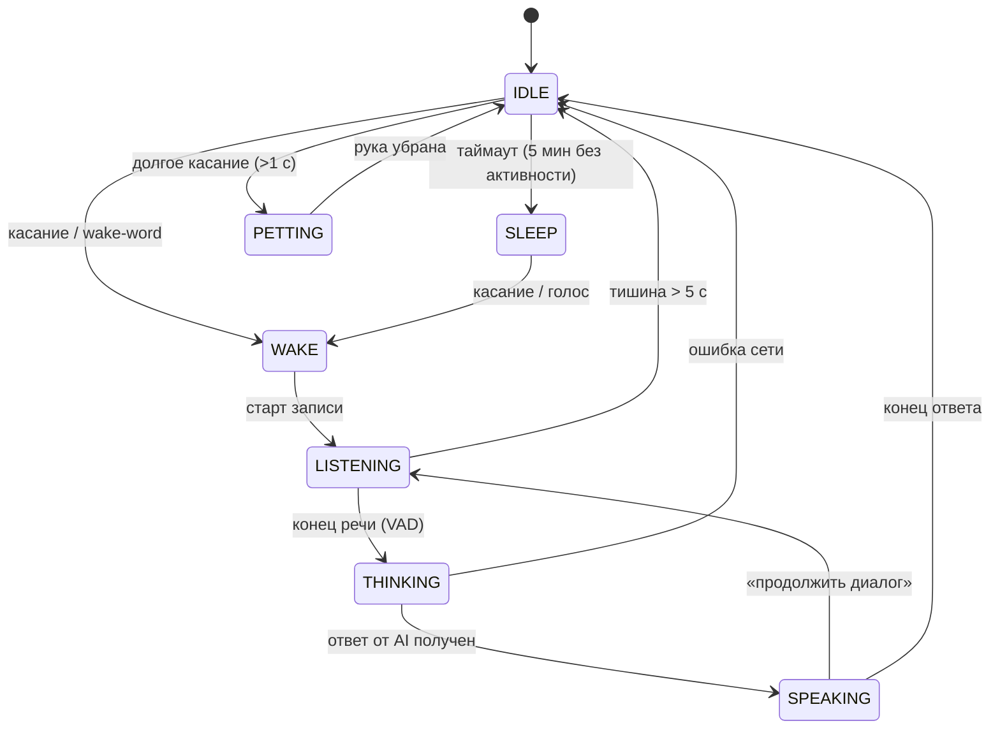

# Конечный автомат состояний питомца

## Состояния

## Описание

| Состояние | Экран | Уши | Поведение |
|-----------|-------|-----|-----------|
| IDLE | мордочка, моргание | расслаблены | ожидание, микрофон в high-power |
| SLEEP | полусомкнутые глаза | опущены | низкое энергопотребление |
| WAKE | широкие глаза | поднимаются | приветствие, переход к прослушиванию |
| LISTENING | глаза смотрят вверх | чуть напряжены | запись с микрофона (I2S) |
| THINKING | точки / крутилка | дёргаются | отправка в AI, ожидание ответа |
| SPEAKING | анимация рта | активные движения | синтез речи (I2S out) |
| PETTING | счастливые глаза-полумесяцы | виляют | реакция на поглаживание |

## Переходы по таймерам

- `IDLE → SLEEP` — 5 минут без касаний и голоса
- `LISTENING → IDLE` — 5 секунд тишины
- `THINKING` — таймаут 10 с, при ошибке → IDLE

## Входные события

- `touch` — фронт датчика TTP223
- `touch_long` — удержание > 1 с
- `wake_word` — распознано слово-триггер
- `speech_end` — энергия речи опустилась ниже порога (VAD)
- `ai_response(text)` — ответ от LLM
- `timeout` — срабатывание таймера
